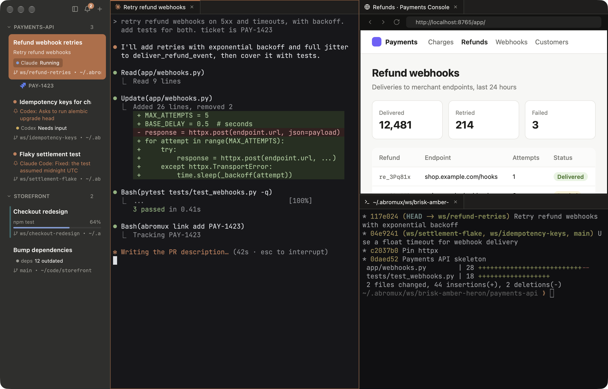
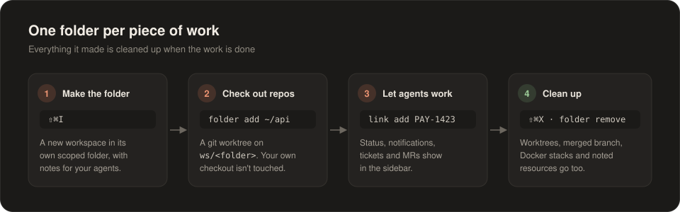
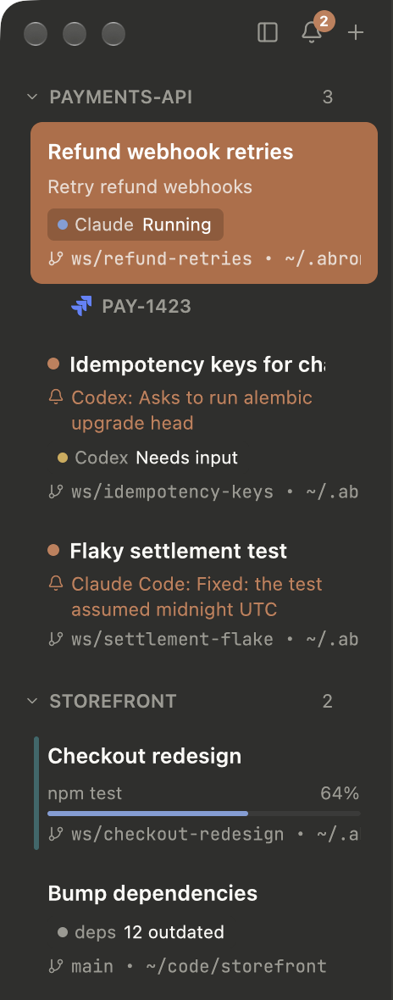
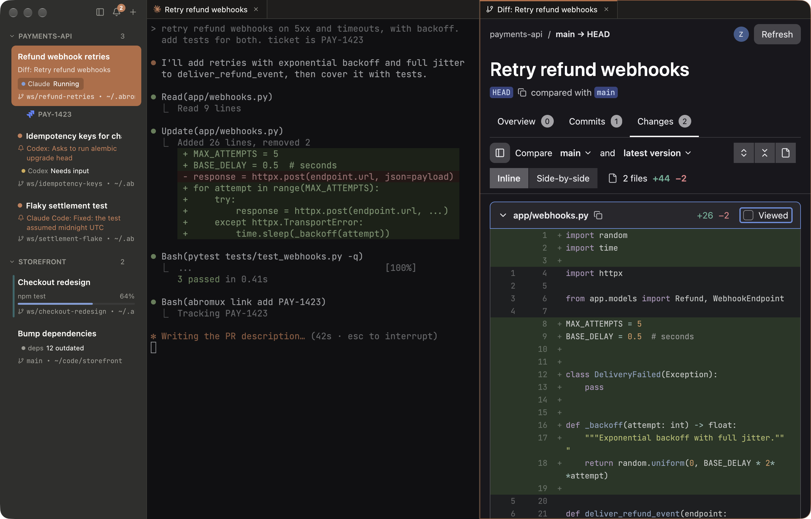
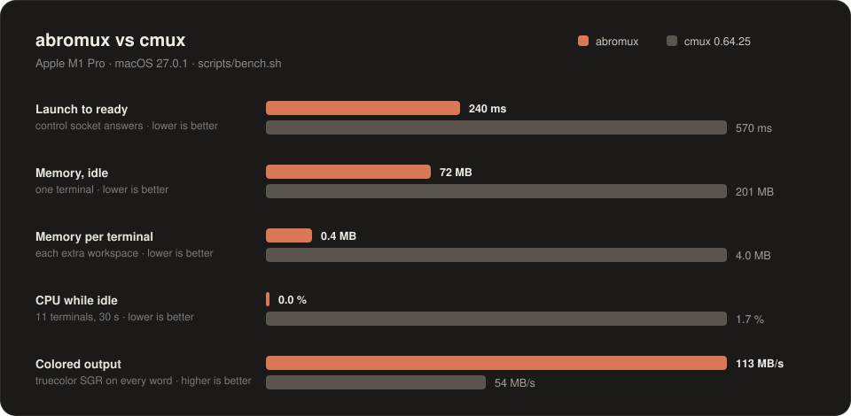

<div align="center">


# AbroMux

**A fast terminal and browser workspace for macOS, made for running many coding agents at once.**

Written fully in Rust with [GPUI](https://gpui.rs) and [libghostty](https://github.com/ghostty-org/ghostty).

[](https://github.com/ZilvinasAbr/abromux/releases/latest)
[](#install)
[](#install)
[](https://gpui.rs)
[](LICENSE)

<a href="https://github.com/ZilvinasAbr/abromux/releases/latest"></a>

<br><br>



</div>

## Why

I love [cmux](https://cmux.com) and use it every day. But with many agents and browser tabs open at once, it started to feel slow. I wanted to see whether a leaner, faster take on the same idea was possible, built fully in Rust. AbroMux is that experiment.

It starts about twice as fast as cmux, uses about a third of the memory, and sits at 0% CPU when nothing is happening.

## AbroMux and cmux

AbroMux follows cmux closely: the same sidebar of workspaces, split panes of terminals and browsers, agent notifications, and a CLI with the same command names, so scripts and habits carry over. It can import your cmux session. Where it goes its own way:

| | AbroMux | cmux |
|---|---|---|
| **Built with** | Rust, GPUI, libghostty-vt | Swift, libghostty |
| **Launch to ready** | ~240 ms | ~570 ms |
| **Memory, idle / per extra terminal** | 72 MB / 0.4 MB | 201 MB / 4.0 MB |
| **CPU while idle** | 0.0 % | 1.7 % |
| **Quitting the app** | shells keep running and come back as they were | shells start fresh |
| **GitLab merge requests** | built-in panel and review tab | |
| **Jira tickets** | tracked per workspace, in the sidebar | |
| **Workspace folders** | git worktree per task, one-command cleanup incl. Docker | |
| **Reviewing local changes** | `abromux diff`: comment on a line, an agent picks it up | |

What cmux has and AbroMux doesn't yet: SSH and remote tmux workspaces, browser profiles and downloads, the canvas layout, a markdown viewer, and cmux's cloud and iOS extras. [docs/missing-cmux-features.md](docs/missing-cmux-features.md) has the full list.

## What it does

<table>
<tr>
<td width="50%" valign="top">

### 🗂️ Workspaces in a sidebar
Each one shows its git branch, folder, what its agent is doing, the latest notification, status pills and progress from your scripts. Give them colors and descriptions, and fold them into groups you can drag around.

</td>
<td width="50%" valign="top">

### 🤖 Knows your agents
Claude Code, Codex, Gemini CLI, Droid, Cursor, OpenCode and Pi show **Running** or **Needs input** in the sidebar, notify you when they ask or finish, and resume after a restart.

</td>
</tr>
<tr>
<td valign="top">

### 🪟 Terminals and browsers side by side
Split panes with tabs of terminals (libghostty) and browsers (native WebKit). Drag tabs between panes, onto edges to split, or onto another workspace.

</td>
<td valign="top">

### 🔍 Review diffs, then hand them back
`abromux diff` shows any git diff as a merge request review. Comment on a line and an agent starts beside it to act on it. GitLab merge requests open in a native review tab too.

</td>
</tr>
<tr>
<td valign="top">

### 🎫 Tickets and MRs with the work
Track a workspace's Jira tickets and merge requests with `abromux link add`. They show under the workspace and open with ⌥⌘1…9.

</td>
<td valign="top">

### ♻️ Nothing lost on restart
Shells keep running while AbroMux is closed and come back as they were. After a reboot the layout, scrollback and agent sessions come back. Your cmux session can be imported.

</td>
</tr>
<tr>
<td valign="top">

### ⌨️ Scriptable
Everything is driven by the `abromux` CLI, with commands named after cmux's: split panes, send keys, read the screen, drive a browser, post status and notifications.

</td>
<td valign="top">

### 🎨 Feels like Ghostty
It reads your Ghostty config for theme, font and colors. Shortcuts can be changed in the config file.

</td>
</tr>
</table>

## One folder per piece of work

Press ⇧⌘I and AbroMux makes a workspace with its own folder. Check projects out into it and each one becomes a git worktree on its own branch, so your main checkout is left alone and several agents can work on the same repo without getting in each other's way. When you're done, one command removes the worktrees, the merged branch and any Docker stacks the work started.

<p align="center">
  
</p>

```bash
abromux folder add ~/code/payments-api      # git worktree on ws/<folder>
abromux link add PAY-1423                   # show the ticket under this workspace
abromux diff main...HEAD                    # review the branch, comments start agents
abromux folder remove                       # worktrees, branch and Docker leftovers go
```

## GitLab and Jira integration

Most work starts from a ticket and ends in a merge request. AbroMux keeps both next to the terminals doing the work.

<table>
<tr>
<td width="34%" valign="top">

</td>
<td valign="top">

### 🎫 Tickets and merge requests per workspace

Each workspace keeps the Jira tickets and merge requests it's about, listed under it in the sidebar with their titles. **⌥⌘1…9** opens one, reusing the tab that already shows it instead of opening a second.

- Tickets and MRs you open in a workspace's tabs are tracked on their own.
- The MRs of the branches checked out in a workspace show up there without you doing anything.
- Agents track what they work on: `abromux link add PAY-1423`.
- ⌘-click a ticket or MR link in a terminal and it opens in the existing tab.

### 🦊 GitLab merge requests panel

**⌥⌘B** opens a panel with this workspace's MRs, yours and those waiting for your review, and the ones you opened lately. They're cached and kept fresh in the background, so any of them opens at once, even after a restart. **⇧⌘M** jumps to any cached MR, or opens one from a pasted link.

</td>
</tr>
</table>

### 🔍 Review in the app, not the browser

Merge requests open in a native review tab modeled on GitLab's own pages: the overview and threads, commits, pipelines, and the changes with a file tree, inline or side-by-side diffs, suggestions and image diffs. You can comment, reply, resolve threads, start threads on lines, mark files viewed and approve. GitLab's keys work too (`j`/`k`, `n`/`p`, `v`). Merge requests with thousands of files still scroll smoothly.

The same view works without GitLab: `abromux diff` shows any local diff as a review beside the terminal. Comment on a line and an agent starts next to it to act on the comment.

<p align="center">
  
</p>

## Fast

<p align="center">
  
</p>

cmux is about 20% faster on plain text, and AbroMux does less than cmux, which explains part of the gap. [docs/perf-vs-cmux.md](docs/perf-vs-cmux.md) has every number, how they were measured and the caveats.

## Install

Download `AbroMux-<version>.dmg` from the [latest release](https://github.com/ZilvinasAbr/abromux/releases/latest), open it and drag AbroMux to Applications. It needs macOS 13 or later on Apple Silicon.

Then, optionally, put the CLI on your PATH, connect your coding agents, and teach them the CLI:

```bash
sudo ln -sf /Applications/AbroMux.app/Contents/MacOS/abromux /usr/local/bin/abromux
abromux hooks install     # agent status, notifications, resume after restart
abromux skills install    # Claude Code and Codex skills for the abromux CLI
```

Coming from cmux? **File › Import cmux Session** brings your workspaces over.

## Script it

```bash
abromux new-split right --type browser --url http://localhost:3000
abromux send "cargo test\n"
abromux set-status tests "passing" --color "#7fb37a"
abromux set-progress 0.6 --label "migrating"
abromux notify --title "Deploy" --body "staging is up"
abromux browser snapshot --interactive
```

Run `abromux --help` for every command.

## Keys you'll use most

| | |
|---|---|
| ⌘N / ⇧⌘I | New workspace / new workspace folder |
| ⌘D / ⌘⇧D | Split right / down |
| ⌘T / ⌘⇧L | New terminal tab / new browser tab |
| ⌘1…9 | Jump to a workspace |
| ⌘P | Switch workspace by name |
| ⌘⇧P | Command palette |
| ⌘⇧U | Jump to the newest unread notification |
| ⌘⇧↩ | Zoom the focused pane |
| ⌥⌘B / ⇧⌘M | Merge requests panel / go to a merge request |
| ⌥⌘1…9 | Open a workspace's tracked ticket or merge request |
| ⌥⌘T | Track the focused page in this workspace |

## Learn more

[docs/guide.md](docs/guide.md) has the full feature list, every keyboard shortcut, the config file, the CLI reference, and how to build AbroMux from source.

## License

[MIT](LICENSE)
